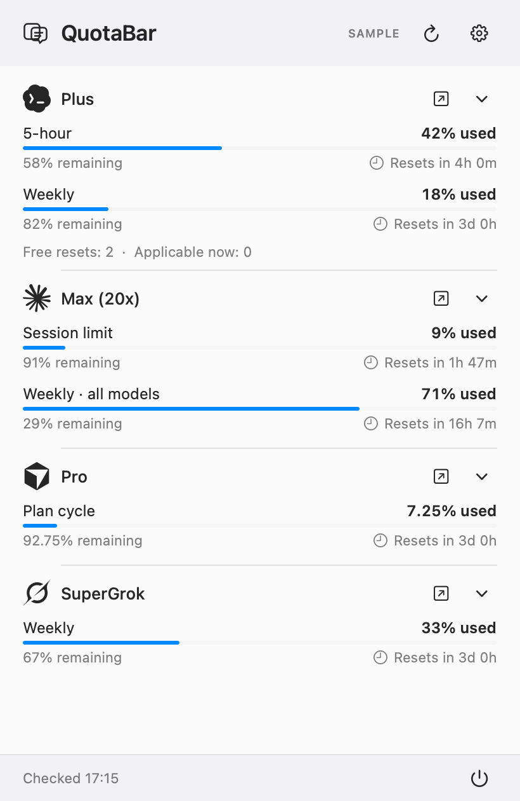
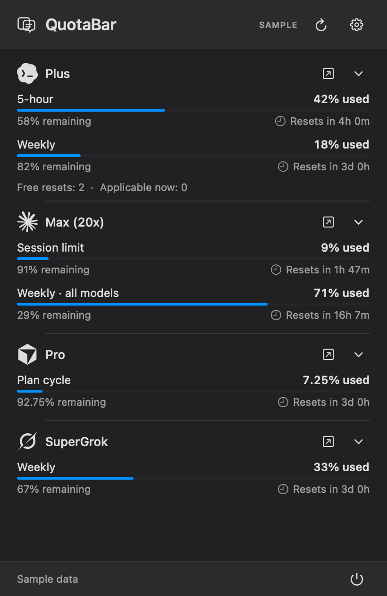

# QuotaBar — AI usage monitor for the macOS menu bar

Check **Claude Code, OpenAI Codex, Cursor, and Grok usage limits and reset times** from one lightweight Mac menu bar app. QuotaBar shows subscription usage, remaining allowance, plan information, and reset countdowns using your existing local sign-ins.

**Free and open source · Manual refresh · No background polling · Native SwiftUI/AppKit**

[Download for Apple silicon](https://github.com/odaofficial/quotabar/releases/latest) · [Install from source](#build-and-install) · [Provider setup](#provider-setup)

Press Refresh or ⌘R when you want a new reading. QuotaBar stays idle between checks and does not scan conversation history, run an embedded browser, or require another account. The installed 0.2.0 app measured about 1.4 MiB; see [verification notes](docs/VERIFICATION.md) for measurement conditions.

Requires macOS 14 or later and Xcode/Swift 6 to build. The app has no third-party runtime packages. The repository is [MIT licensed](LICENSE).

 

All screenshots use sample data. The app starts idle; press the refresh icon or ⌘R to check usage. Relative reset labels update when you open the panel or refresh. Hover over a reset time for its exact date. The chevrons reveal additional allowance windows and account details.

## Track AI subscription limits and reset times

| Provider | What QuotaBar can show |
| --- | --- |
| Claude Code | Session limit, weekly all-model usage, available model-specific limits, reset times, and recognized Pro/Max plan tiers |
| OpenAI Codex | Provider-reported usage windows, reset times, credits and available resets when supplied |
| Cursor | Plan-cycle usage, billing-cycle reset, and on-demand or team allowances when supplied |
| Grok | Usage for the reported allowance period, reset time, and available credit information; requires a working Grok CLI sign-in |

Every percentage is labeled **used**, with **remaining** below it. Missing data stays unknown. Failed checks clearly distinguish retained stale data from a check that returned no data. Launch at login is optional after the first installed launch.

## Download

The [latest release](https://github.com/odaofficial/quotabar/releases/latest) includes an Apple silicon app for macOS 14+. Extract it, move **QuotaBar.app** to `~/Applications` or `/Applications`, and open it. The context/chat icon appears in the menu bar. Usage checks run when you press Refresh; the app has no background polling, embedded browser, or always-running helper.

Release binaries are ad hoc signed for local use, not Apple-notarized. If macOS refuses to open the downloaded binary, build from source below or review it before using the macOS app-approval flow. Do not disable Gatekeeper globally.

## Build and install

With Git and Swift 6 installed, run:

```sh
git clone https://github.com/odaofficial/quotabar.git
cd quotabar
./Scripts/install.sh
open "$HOME/Applications/QuotaBar.app"
```

The install script builds the app when needed. Contributors can run `swift test` and `./Scripts/package.sh` separately.

The first normal launch from `~/Applications` or `/Applications` requests macOS launch-at-login registration. Its current status and toggle are in Settings. If macOS requires approval, enable it in System Settings → General → Login Items. The app has no Dock icon. To remove it, disable launch at login in Settings, quit, and remove the app from `~/Applications`.

To preview synthetic usage without reading credentials, making requests, registering login, or changing preferences:

```sh
.build/release/QuotaBar --demo --show
```

To run a read-only live check with redacted output:

```sh
.build/release/QuotaBar --diagnostics
```

The diagnostic output includes provider name, plan, window labels, used percentages, reset times, and connection status. It does not print account IDs, response bodies, tokens, or email addresses. It never asks for Keychain access.

For a two-second startup check using synthetic data:

```sh
.build/release/QuotaBar --demo --smoke-test
```

This reports whether AppKit completed launch, created the status item, and hosted the popover. A normal `--smoke-test` also reports login-item status. To render the synthetic popover without reading sessions or changing preferences:

```sh
.build/release/QuotaBar --render-demo /tmp/quotabar-light.png --appearance light
.build/release/QuotaBar --render-demo /tmp/quotabar-dark.png --appearance dark
.build/release/QuotaBar --render-demo /tmp/quotabar-settings.png --settings
.build/release/QuotaBar --render-demo /tmp/quotabar-mixed.png --scenario mixed
.build/release/QuotaBar --render-demo /tmp/quotabar-empty.png --scenario empty
.build/release/QuotaBar --render-demo /tmp/quotabar-expanded.png --scenario expanded
.build/release/QuotaBar --render-demo /tmp/quotabar-initial.png --scenario initial
```

The previews are opaque 410 × 630 point PNGs at 2× resolution. While the popover has keyboard focus, ⌘R refreshes, ⌘, opens Settings, ⌘Q quits, and Escape returns or dismisses.

## Provider setup

- **Codex:** Run `codex login`. The app reads `~/.codex/auth.json`, or `$CODEX_HOME/auth.json`, and asks the ChatGPT usage endpoint. Some Codex installs keep credentials only in Keychain; those sessions may require signing in through the CLI to create the file.
- **Claude:** Run `claude auth login`. The app reads `~/.claude/.credentials.json`, or `$CLAUDE_CONFIG_DIR/.credentials.json`. If needed, choose **Connect Claude Keychain** in the popover to allow the existing Claude Code Keychain entry. No prompt appears at startup. Recognized Claude plan tiers come from the same sign-in metadata; after changing plans, re-authenticate through Claude if that metadata is out of date.
- **Cursor:** Sign in to the Cursor desktop app. QuotaBar reads Cursor's local SQLite state in read-only mode.
- **Grok:** Run `grok login`. The app reads `$GROK_HOME/auth.json` or `~/.grok/auth.json`. Expired Grok sessions must be renewed by Grok CLI; QuotaBar cannot refresh them.

Sessions remain owned by their provider apps. QuotaBar never rotates tokens. If a provider session expires, sign in through that provider and refresh. Availability of these undocumented usage endpoints can change; an unrecognized or missing field appears as unknown instead of a fabricated zero.

See [Privacy and security](docs/PRIVACY.md) for data handling details.

## Frequently asked questions

### How do I check Claude Code usage limits on a Mac?

Sign in through Claude Code, open QuotaBar, and press Refresh. The Claude section shows the session and weekly limits supplied by your account, with reset countdowns. If Keychain access needs approval, QuotaBar shows an explicit Connect action.

### Can I track Codex and Cursor usage in the same menu bar app?

Yes. QuotaBar includes Codex, Claude, Cursor, and Grok in one panel. Each provider keeps its own quota windows and reset times. Enable the services you use in Settings.

### Does QuotaBar refresh automatically?

No. Usage requests happen only when you press Refresh or explicitly connect Claude. Opening the panel updates the displayed reset countdown from the last reading without making a usage request.

### Is this an API token counter or an API cost tracker?

QuotaBar focuses on subscription usage limits and reset times. It displays credits or spending only when a provider reports them; it does not count tokens from your conversations or estimate per-project API costs.

### Does it work on Intel Macs, Windows, or Linux?

The downloadable app is for Apple silicon Macs running macOS 14 or later. The Swift sources also build on Intel macOS in CI. Windows and Linux are not supported.

## Verification and integration sources

See [verification notes](docs/VERIFICATION.md) for test coverage, observed resource use, and live integration limits. Grok requires a working Grok CLI login; its parser is fixture-tested in this release.

The implementation is original Swift code. The 0.2.0 panel applies the user-selected Apple Design skill, drawing on [Apple’s Designing Fluid Interfaces](https://developer.apple.com/videos/play/wwdc2018/803/), alongside the [macOS design skill](https://github.com/ceorkm/macos-design-skill/blob/main/SKILL.md). [Provider marks and licenses](docs/THIRD-PARTY.md) are recorded separately. Usage contracts were checked against [OpenAI Codex](https://github.com/openai/codex), [xAI Grok Build](https://github.com/xai-org/grok-build), and [CodexBar](https://github.com/steipete/CodexBar). Thanks to those projects for documenting their integration behavior. Provider names and marks belong to their respective owners; this app is not affiliated with the providers.
